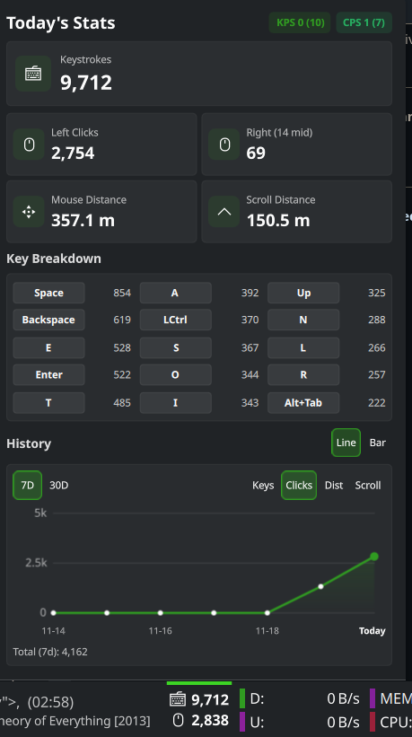

# KeyStats KDE Plasma 6 Widget

A native KDE Plasma 6 Plasmoid for `keystats-daemon` that displays live keyboard and mouse statistics in your Plasma panel.

## Features
- **Adaptive Panel Indicator:** Automatically stacks keystrokes and mouse clicks vertically on thick panels (`>= 36px`) or displays them inline on thin panels.
- **Live KPS & CPS Badges:** Real-time and peak keystrokes/clicks per second in the popup header.
- **2×2 Metric Cards:** Today's Keystrokes, Mouse Clicks, Mouse Distance (`px` → `m` → `km`), and Scroll Distance.
- **Last 7 Days Chart:** Interactive **Keys / Clicks** toggle line chart powered by `keystatsctl history`.
- **Top Keys Today:** Breakdown of your top 5 most-pressed keys with proportional bars.



## Installation

1. Ensure `keystats-daemon` and `keystatsctl` are installed and running:
   ```bash
   cargo build --release
   sudo install -Dm755 target/release/keystats-daemon /usr/local/bin/keystats-daemon
   sudo install -Dm755 target/release/keystatsctl /usr/local/bin/keystatsctl
   systemctl --user enable --now keystats
   ```
2. Install the Plasma 6 widget from the repository root:
   ```bash
   make install-plasma
   ```
   *(Or manually copy `plasma-widget/io.github.0x5c0f.keystats` to `~/.local/share/plasma/plasmoids/`.)*
3. Right-click your Plasma panel → **Add or Manage Widgets** → search for **KeyStats** and add it to your panel.
